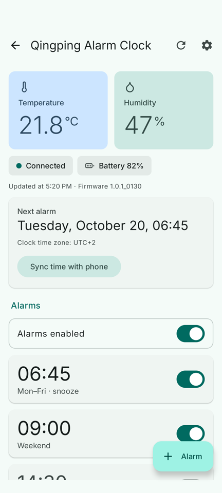
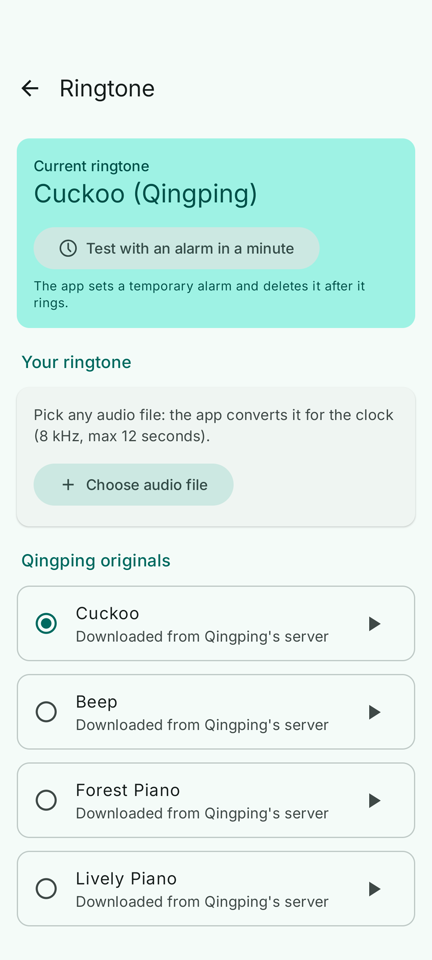
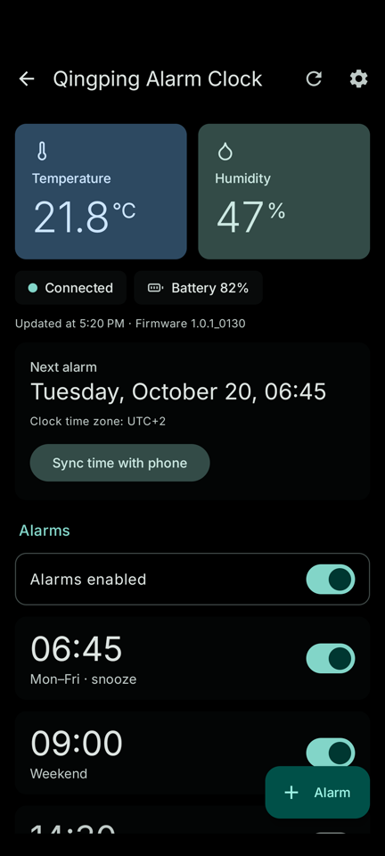
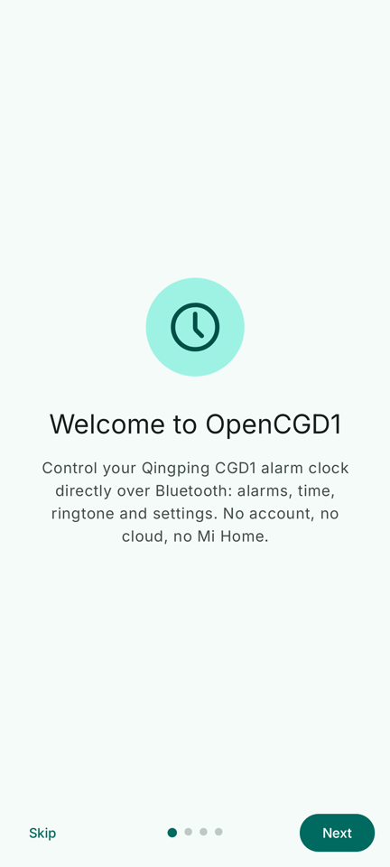
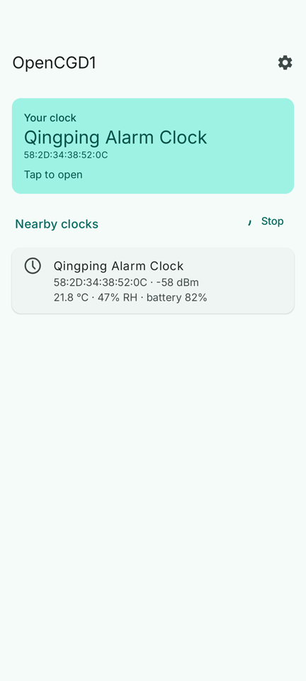
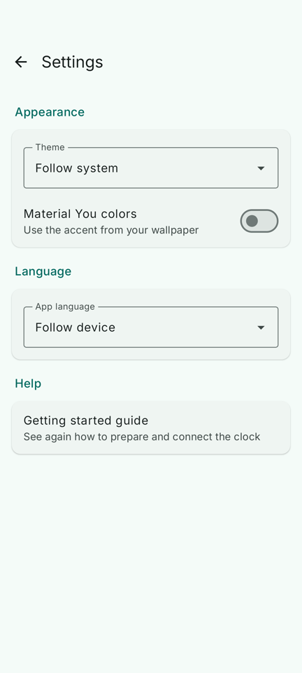

<div align="center">


# OpenCGD1

**Your Qingping CGD1 Bluetooth alarm clock, without Mi Home.**

An open source Android app that controls the clock locally over Bluetooth: no account, no cloud.

[](https://github.com/Mr-Flower/OpenCGD1/actions/workflows/build.yml)
[](https://github.com/Mr-Flower/OpenCGD1/releases/latest)

[](LICENSE)

[**Download the latest version**](https://github.com/Mr-Flower/OpenCGD1/releases/latest)

</div>

<p align="center">
  
  
  
</p>

## Features

| | |
|---|---|
| 🌡️ **Dashboard** | Live temperature and humidity, battery level, connection status |
| ⏰ **Alarms** | All 16 slots: time, weekdays, snooze, on/off, master switch and next alarm |
| 🕒 **Exact time** | Time and time zone synced from the phone on every connection, aligned to the second |
| 🔔 **Ringtones** | The 9 Qingping originals, 18 bundled alarm sounds or your own audio file. Try it with an alarm one minute from now |
| ⚙️ **Clock settings** | Volume with a test beep, 12/24 h, °C/°F, display language, day/night brightness, screen light, night mode |
| 🎨 **Look** | Material 3, light/dark/AMOLED themes, optional Material You colors |
| 🌍 **Languages** | English, Español, Français, Italiano, or the phone's language |

## Installation

1. Download `OpenCGD1-x.y.z.apk` from the [latest release](https://github.com/Mr-Flower/OpenCGD1/releases/latest) and open it on your phone.
2. If Android asks, allow installs from that source. Play Protect may flag the app as unknown: that's normal for apps outside the Play Store.

Every new version installs over the previous one. To get updates automatically, add this repository to [Obtainium](https://github.com/ImranR98/Obtainium).

> Versions up to 0.5.0 were signed with a different key: if you are coming from one of them, uninstall it once before installing the new one.

## First connection



The clock accepts **only one app at a time**. If you have used it with Mi Home or Qingping+, release it first:

1. remove it from Mi Home or Qingping+, **or** hold the clock's button until the Bluetooth icon blinks;
2. open OpenCGD1 and follow the guide: grant the Bluetooth permission and the search starts by itself;
3. tap your clock. On the first connection it binds to the app and keeps working from then on.

After that Mi Home no longer sees it, which is the whole point.

<br clear="right">

## Ringtones

The clock stores **a single ringtone**: choosing one means uploading it over Bluetooth, which takes a few tens of seconds with the phone nearby.

- **Qingping originals**: the 9 ringtones of the official app, downloaded on demand from Qingping's own server (the same one their app uses). They are not included in the repository or the APK.
- **Bundled**: 18 alarm sounds from the Android Open Source Project.
- **Your own**: any audio file Android can read (mp3, ogg, wav, m4a…).

Audio is tuned for the clock's tiny speaker: bass it can't play is removed, the sound is compressed to come out louder, matched to the level of the original ringtones and trimmed to 12 seconds. You can preview it on the phone before uploading, and **Test with an alarm in a minute** lets you hear it from the clock itself.

## FAQ

<details>
<summary><b>Which clocks does it work with?</b></summary>

Any **Qingping CGD1**, including units sold as "Qingping Bluetooth Alarm Clock", the Mi Home edition or the older ClearGrass branding. It does not work with other Qingping models or clocks from other brands.
</details>

<details>
<summary><b>Does it need internet?</b></summary>

No, everything goes over Bluetooth. The app only goes online when you open the ringtone screen, to fetch the list and files of the Qingping originals.
</details>

<details>
<summary><b>Why doesn't the battery level always show up right away?</b></summary>

The CGD1 only reports its battery in the data it broadcasts while not connected (the "standard" Bluetooth battery reading always says 99% and can't be trusted). The app listens for a few seconds before connecting, and the dashboard shows when the reading was taken.
</details>

<details>
<summary><b>What about daylight saving time?</b></summary>

The clock doesn't know about it. Just open the app after the change: time zone and time realign by themselves.
</details>

<details>
<summary><b>Can I update the clock's firmware?</b></summary>

Not from OpenCGD1. The update protocol is undocumented, firmware files are only distributed by Qingping, and a failed update can brick the clock. If you really need it, use the Qingping+ app, then reconnect the clock to OpenCGD1.
</details>

<details>
<summary><b>Can I use it from two phones?</b></summary>

Yes. OpenCGD1 uses the same pairing code on every phone, so two phones running the app can control the same clock without resetting it.
</details>

## More screenshots

<p align="center">
  
  
</p>

---

## For developers

<details>
<summary><b>Building</b></summary>

You need JDK 17 and the Android SDK. Open the folder in Android Studio, or from a terminal:

```bash
./gradlew testDebugUnitTest lintDebug assembleRelease   # tests, lint and APK
./gradlew connectedDebugAndroidTest                      # tests on a device or emulator
```

Every push to `main` runs tests and lint on GitHub Actions and produces a signed APK.

**Signing.** The key is not in the repository. CI reads it from the `OPENCGD1_KEYSTORE_BASE64`, `OPENCGD1_STORE_PASSWORD`, `OPENCGD1_KEY_ALIAS` and `OPENCGD1_KEY_PASSWORD` secrets; local builds from a `keystore.properties` file (ignored by git) with `storeFile`, `storePassword`, `keyAlias` and `keyPassword`. Without a key, release builds fall back to the debug key.
</details>

<details>
<summary><b>Architecture</b></summary>

Kotlin, Jetpack Compose and Material 3, MVVM with one immutable state per screen and a separate one-shot effects stream. Hilt for DI, coroutines and Flow, DataStore for preferences.

```
app/src/main/java/it/cgd1/sveglia/
  protocol/    CGD1 protocol encoding: pure Kotlin, no Android
  audio/       ringtone PCM conversion: pure Kotlin
  ble/         coroutine-based GATT client and BLE scanner
  data/        repositories: the only boundary to Bluetooth and network, errors as domain types
    ringtone/  ringtone catalog, downloads, decoding, preview
  di/          Hilt modules
  ui/          Compose screens, ViewModels, theme
app/src/test/         JVM tests (protocol, audio, ViewModel)
app/src/androidTest/  device tests (audio decoding, Qingping server, UI)
tools/                convert_ringtone.py to prepare bundled ringtones
```

- Platform errors stay in the data layer: the ViewModel receives `Result` values with domain errors.
- All text lives in resources; the ViewModel emits `UiText` and the UI resolves it.
- Screens depend on `*Actions` interfaces rather than the ViewModel, so they have `@Preview`s and are testable on their own.
- Dependencies live in `gradle/libs.versions.toml` and are kept up to date by Dependabot.

To add a bundled ringtone: `python3 tools/convert_ringtone.py input.ogg app/src/main/res/raw/ringtone_name.pcm`, then add an entry with a new signature to `BuiltInRingtones.kt`.
</details>

<details>
<summary><b>Protocol notes</b></summary>

- Service `22210000-554a-4546-5542-46534450464d`; characteristics `0x0001`/`0x0002` (authentication) and `0x000B`/`0x000C` (data).
- Authentication: `11 01 + token`, `11 02 + token`, then a settings read as proof, since the clock acknowledges wrong tokens too.
- Battery only from the `FDCD` advertisement (TLV field `02`, mask bit 7). Temperature and humidity also from the `0x0100` notification while connected.
- `02 04 + volume` plays a beep at that volume, not the ringtone: hearing the ringtone takes a real alarm.
- Ringtone: `08 10 + length (3 bytes LE) + signature (4 bytes)`, then `81 08 + 128 bytes` packets, acknowledged with `04 ff 08` every 512 bytes; needs an MTU of at least 133. Audio (8-bit unsigned PCM, 8 kHz, mono) ends with `00` and is padded with `FF` to the block size.
- Time: UTC epoch in whole seconds, sent at the start of the next second. The time zone lives in the settings, in 6-minute steps.
</details>

## Credits

- [qingping-cgd1](https://github.com/rjocoleman/qingping-cgd1) by Robert Coleman: the Python library this app started from.
- [clOwOck](https://github.com/MrBoombastic/clOwOck) and [cgd1-rs](https://github.com/smearor/cgd1-rs): reverse engineering of the protocol, ringtones and sensors.
- Alarm sounds from the [Android Open Source Project](https://android.googlesource.com/platform/frameworks/base/+/refs/heads/main/data/sounds), [Inter](https://github.com/rsms/inter) font, [Lucide](https://lucide.dev) icons.

OpenCGD1 is not affiliated with Qingping or Xiaomi. Qingping and CGD1 are trademarks of their respective owners.

## License

[MIT](LICENSE). Sounds, font and icons have their own licenses, listed in [`third_party/`](third_party/README.md).
